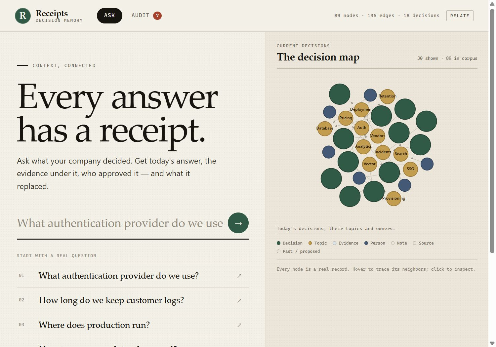
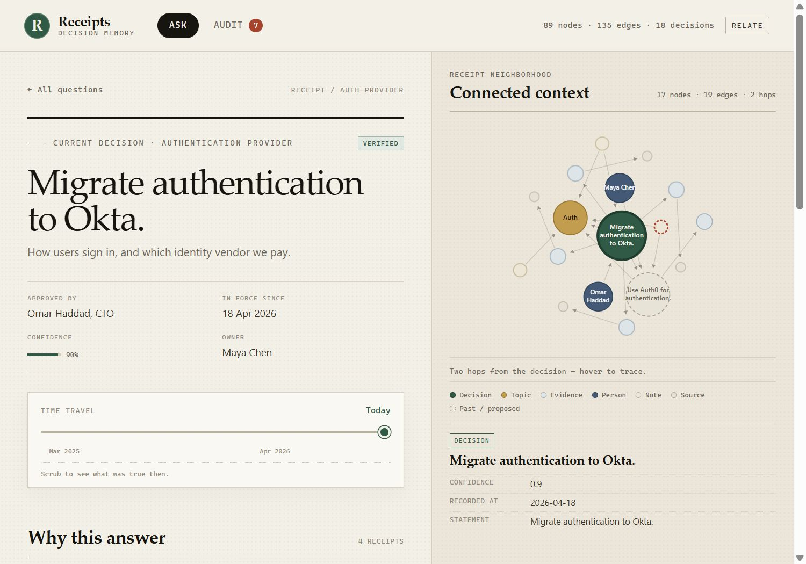
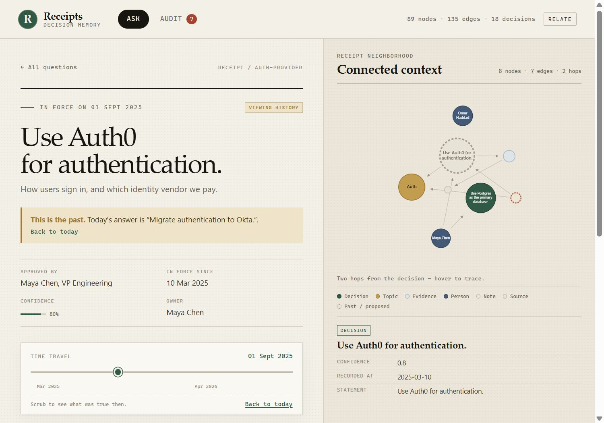
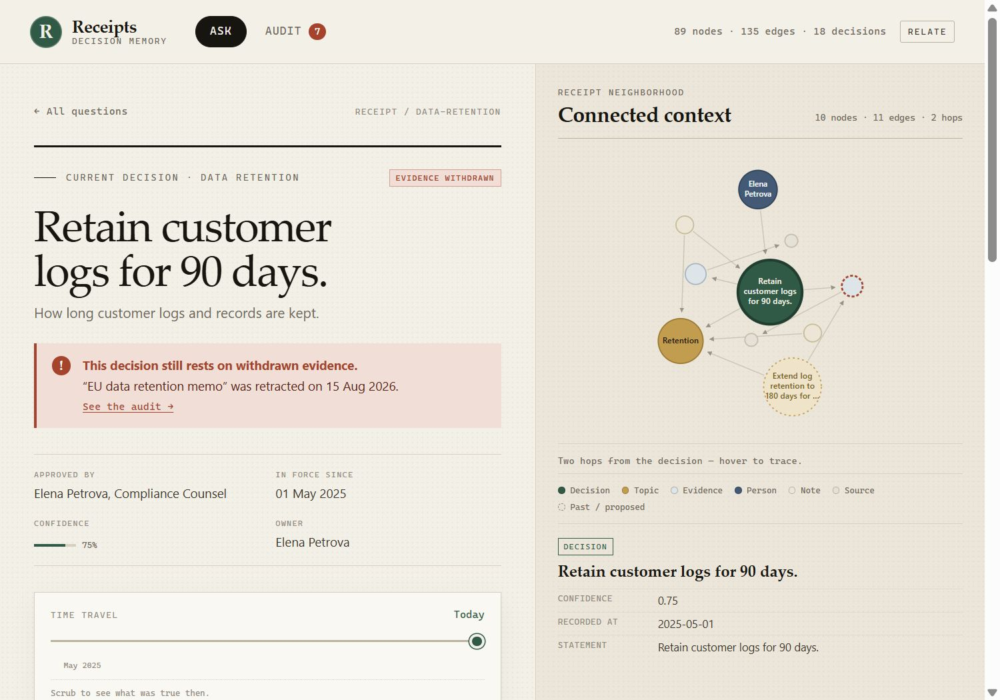
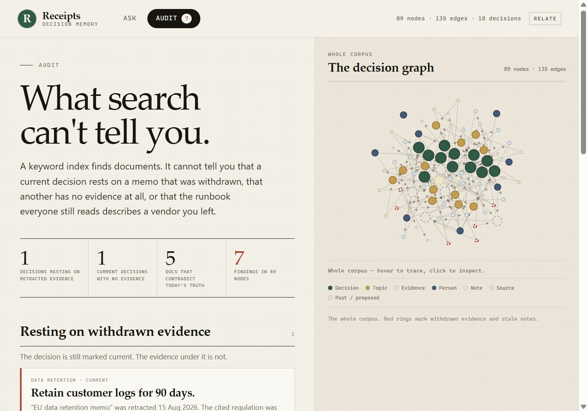

# Receipts

**Every answer has a receipt.** A decision-memory app that answers "what did we decide?" with the evidence, the approver, the decision it replaced, and the date it stopped being true — all traversals of one Relate graph.



**Live demo:** https://iahmedak.github.io/receipts/ *(deployed from `main` by GitHub Actions)*
**Demo video:** [watch the 2-minute walkthrough](docs/demo.mp4)

---

## Use case

Search can find the document that says "use Auth0". It cannot tell you that the decision was superseded by Okta in April, that the runbook everyone still reads is therefore wrong, that a current decision rests on a memo that was retracted, or that another was approved with no evidence at all.

Receipts is for engineers, PMs and auditors who need to know **what is true now**, **why**, **who signed it**, and **what it replaced**. The demo corpus is a fictional company, Northwind Labs, seeded with deliberate audit gaps so the graph has something real to reveal.

### What connects to what

| Relationship | Meaning |
| --- | --- |
| `(Decision)-[:ABOUT]->(Topic)` | A decision answers a recurring question |
| `(Decision)-[:SUPERSEDES]->(Decision)` | A chain of what was true before |
| `(Decision)-[:BASED_ON]->(Evidence)` | The receipts under an answer |
| `(Evidence)-[:FROM]->(Source)` | Where the evidence came from |
| `(Evidence)-[:CONTRADICTS]->(Evidence)` | Conflicting source material |
| `(Person)-[:APPROVED]->(Decision)` | Who signed it |
| `(Person)-[:OWNS]->(Topic)` | Who is accountable for the question |
| `(Note)-[:RECORDS]->(Decision)` | What a document claims |
| `(Note)-[:MENTIONS]->(Topic)` | What a document talks about |

None of these answers can be produced by filtering a row; they are **graph traversals**. Supersession is a variable-length path, staleness is a path from a current decision back to the decision a note recorded, and the receipt neighbourhood is a two-hop expansion.

---

## How it uses Relate

- **Mode:** **single file** for the CLI/Node path (`data/receipts.rl`) and **in memory (WebAssembly)** for the browser demo.
- **Why this mode:** the single `.rl` file is committed to the repo, so judges can open and query the exact graph the UI shows without running the app. The browser needs zero install, so the WASM build seeds the identical graph in memory on load and executes every query client-side — no server, no signup, no network call.
- **What the graph models:** 89 nodes (8 people, 12 topics, 12 sources, 22 evidence items, 18 decisions, 17 notes) and 135 typed relationships.

### Relate capabilities used

- Property graph with typed nodes and directed, typed relationships.
- Cypher: `MATCH`, `OPTIONAL MATCH`, `WHERE`, `CASE`, `EXISTS { ... }`, `UNWIND`, `collect()`, list comprehensions, `any()`, variable-length paths (`*1..5`), and `ORDER BY` / `LIMIT`.
- Uniqueness constraints and indexes, created by the shared seed module.
- Single-statement queries with JSON parameters and JSON envelopes; errors are reported in the envelope and surfaced in the UI.
- The same `.rl` store works with the native Node library and the `relate` CLI; the same queries run unchanged against `@relate/relate-wasm` in the browser.
- Deterministic seeding: one graph definition (`src/seed-graph.js`) drives both runtimes.

### Third-party tools

- [Relate](https://relatedb.ai) v1.3.0 — `@relate/relate` (Node/CLI store) and `@relate/relate-wasm` (browser engine).
- Vite 8 — dev server, production build and the `?url` WASM asset import.
- Vanilla JavaScript (ES modules), CSS and hand-rendered SVG — no UI framework, no graph library.
- GitHub Actions — builds and publishes the static demo to GitHub Pages.
- GitHub CLI — repository setup during development only.

### AI tools

- Built with the **OpenCode** coding agent (DeepSeek V4.1 Flash Free).
- Relate's installable coding-agent skill was used as the API reference while developing.
- No AI is used at runtime. Every answer in the app is a Cypher query executed by Relate against the seeded graph; the prose in the corpus is fictional and human-authored.

---

## Setup and run

Requires Node.js 22 (or 20.19+) and npm.

```bash
npm ci
npm run seed      # rebuild data/receipts.rl from data/seed.json
npm run verify    # run the demo's Cypher against the persistent store
npm run dev       # http://localhost:5173 — browser demo (WASM, no server)
```

For a production build:

```bash
npm run build
npm run preview   # http://localhost:4173
```

Query the committed store directly with the Relate CLI ([install guide](https://relatedb.ai/docs/get-started/install)):

```bash
relate -d data/receipts.rl --mode table \
  "MATCH (d:Decision {status: 'current'})-[:ABOUT]->(t:Topic) RETURN t.name, d.statement"
```

`npm run verify` prints the exact answers used in the demo: the current authentication decision, both time-travel states, the withdrawn-evidence finding, the unsupported decision, five stale notes and all supersession chains.

---

## Where the data lives

| Path | What it is |
| --- | --- |
| `data/receipts.rl` | **The persistent Relate store** — single-file mode, 89 nodes / 135 relationships, committed for inspection. |
| `data/seed.json` | Human-readable source of truth for the fictional Northwind Labs corpus. |
| `src/seed-graph.js` | The one graph definition used by both the Node seed script and the browser WASM adapter. |
| `src/queries.js` | All 20 Cypher statements, shared by the UI and the CLI verifier. |

The browser cannot load a `.rl` file into WASM, so `src/db.js` rebuilds the same graph in memory from `data/seed.json` at boot. The CLI writes the byte-level persistent equivalent into `data/receipts.rl`.

---

## Try these

1. **Ask** "What authentication provider do we use?" → the current answer is Okta, approved by the CTO, with four evidence receipts.
2. **Scrub the time slider** to September 2025 → the answer becomes Auth0 and the graph prunes decisions, evidence and notes that did not exist yet.
3. **Ask** "How long do we keep customer logs?" → the answer is still marked current, but a red banner shows that its legal memo was retracted. Click **See the audit**.
4. **Open the Audit tab** → seven findings: one decision resting on withdrawn evidence, one current decision with zero evidence, and five documents that contradict today's truth.
5. **Hover or click any node** in the right-hand graph to trace its neighbours or inspect its properties.






---

## How the answers are computed

```cypher
// What was true on a given date: validity interval + supersession, no LLM.
MATCH (t:Topic {slug: $slug})<-[:ABOUT]-(d:Decision)
WHERE d.valid_from <= $asOf
  AND (d.valid_to IS NULL OR d.valid_to > $asOf)
RETURN d.statement, d.valid_from, d.valid_to
ORDER BY d.valid_from DESC LIMIT 1
```

```cypher
// A current decision whose evidence was retracted.
MATCH (d:Decision)-[:BASED_ON]->(e:Evidence)
WHERE d.status = 'current' AND e.status = 'retracted'
RETURN d.statement, e.title, e.retracted_at, e.reason
```

```cypher
// Current, approved, and completely unsupported.
MATCH (d:Decision)
WHERE d.status = 'current'
  AND NOT EXISTS { (d)-[:BASED_ON]->(:Evidence) }
RETURN d.statement, d.valid_from
```

```cypher
// A still-canonical note whose decision was replaced by a current one.
MATCH (n:Note)-[:RECORDS]->(old:Decision)
MATCH (current:Decision)-[:SUPERSEDES*1..5]->(old)
WHERE current.status = 'current'
RETURN n.title, old.statement AS note_says,
       current.statement AS current_truth
```

All queries are in `src/queries.js`; the audit view renders the three audit statements verbatim in a collapsible panel so judges can see the Cypher behind each finding.

---

## Architecture

```
data/seed.json ──> src/seed-graph.js ──┬──> scripts/build-store.mjs ──> data/receipts.rl
                                       │                                  │
                                       │                                  ├─> relate CLI
                                       │                                  └─> @relate/relate (Node verify)
                                       └──> src/db.js ──> @relate/relate-wasm (browser, in memory)
                                                             │
                                  src/queries.js ────────────┤
                                                             └──> src/main.js ──> src/graph.js
                                                                  (ask / receipt / time travel / audit)
```

The force layout in `src/layout.js` is deterministic (fixed seed), so the graph and screenshots are reproducible. Dates are stored as ISO strings so lexical comparison works identically in the native and WASM engines.

---

## Demo video

[`docs/demo.mp4`](docs/demo.mp4) — 2-minute walkthrough: home → ask → receipt → time travel → withdrawn evidence → audit.

---

## Limitations and next steps

- The corpus is fictional and small by design; it is a demo of the pattern, not a production knowledge base.
- Dates are ISO strings rather than temporal values, which keeps both Relate engines consistent but means no timezone arithmetic.
- The WASM build has no `.rl` loader, so the browser seeds from JSON instead of reading the committed store; the shared seed module keeps them equivalent.
- The browser layout is tuned for desktop; below 940 px the graph moves below the answer.
- Natural-language input is mapped to topic/notes search by substring, not by an embedding model.

---

## License

MIT — see [LICENSE](LICENSE).
